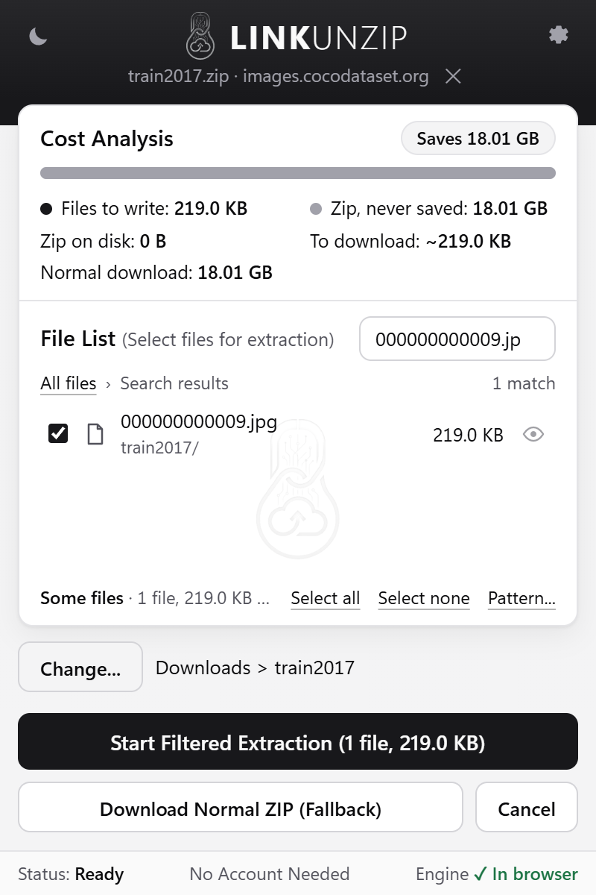
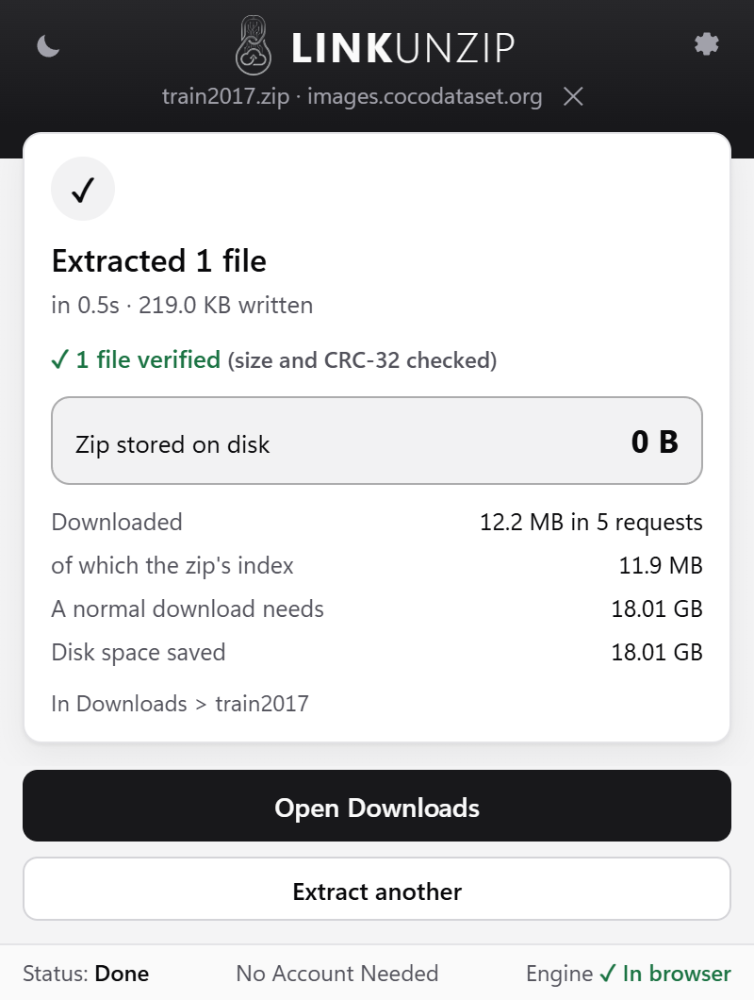

<p align="center">
  
</p>

<h1 align="center">LinkUnzip</h1>

<p align="center">
  <b>Extract a ZIP straight from a link into a folder, without ever saving the ZIP.</b><br>
  A browser extension for Chrome, Edge and Brave. Nothing else to install.
</p>

<p align="center">
  <a href="https://github.com/CincaAlex/LinkUnzip/actions/workflows/ci.yml"></a>
  <a href="https://chromewebstore.google.com/detail/dapeiljhjlaelolngnoagobeojcpkica?utm_source=github&utm_medium=readme"></a>
  <a href="LICENSE"></a>
  
</p>

<p align="center">
  <a href="https://linkunzip.app">Website</a> |
  <a href="#install">Install</a> |
  <a href="#how-to-use-it">How to use it</a> |
  <a href="#faq">FAQ</a> |
  <a href="docs/privacy.md">Privacy</a>
</p>

<p align="center">
  <picture>
    <source media="(prefers-color-scheme: dark)" srcset="docs/images/popup-pick-dark.png">
    
  </picture>
  &nbsp;&nbsp;
  <picture>
    <source media="(prefers-color-scheme: dark)" srcset="docs/images/popup-done-dark.png">
    
  </picture>
</p>

## Why

To unpack a zip from the internet you normally download all of it first, so your disk needs room
for the zip *and* the files, and you wait for the whole archive even when you only need one folder.

LinkUnzip reads the zip's index from the end of the file, shows you what is inside and what it will
cost, then downloads only the parts it needs and saves the files straight into your Downloads
folder, or a folder you choose. The zip itself is never saved.

Measured on the developer's PC, in Chrome:

| Archive | Result |
|---|---|
| Blender 4.2 for Windows (365.8 MB zip, 5,518 files), into a folder you choose | 925.6 MB written, 365.2 MB downloaded in 8 requests (including the 1.0 MB index), 0 B of zip on disk, every file verified, in 52 s. A normal download-then-extract needs 1.26 GB. |
| One photo out of COCO train2017 (18.01 GB zip, 118,287 files) | 12.2 MB downloaded (the 11.9 MB index and the 219 KB photo), in about 6 s. |

Sizes are shown the way Windows shows them (1 GB = 1024 MB).

## Features

- **See the cost first.** Before anything is written, the *Cost Analysis* shows what LinkUnzip will
  write and what a normal download-then-extract would need.
- **Take only what you need.** Tick files and folders in the *File List*, or search every name with
  *Filter*. Files you leave out are never downloaded.
- **Preview without extracting.** The eye at the end of a file row opens it in a tab: text and code,
  CSV as a table, images, PDF, audio and video. Only that file is downloaded.
- **Every file checked.** Each file is checked (size and CRC-32) before it gets its real name. A file
  that doesn't check out never appears.
- **Into Downloads, or a folder you choose.** Downloads needs no setup at all; a folder you choose is
  much faster for zips with thousands of files.
- **Fast.** Several connections at once (4 by default, up to 16).
- **Resume.** Stopped halfway, or the network dropped? Resume skips the files that are already done.
- **Big archives.** ZIP64, no 2 GB limit.
- **Private links.** If a download needs your login, LinkUnzip asks before using it on that site.
- **Light and dark**, following your system or your choice.
- **No account, no ads, no uploads, no tracking.**

## Install

Add LinkUnzip from the [Chrome Web Store](https://chromewebstore.google.com/detail/dapeiljhjlaelolngnoagobeojcpkica?utm_source=github&utm_medium=readme). Edge, Brave and Chromium can
install it from there too (in Edge, click **Allow extensions from other stores** when it asks).
The Edge Add-ons listing will follow. You can also [run it from source](#build-from-source).

That's all: LinkUnzip works inside the browser. A **Set up LinkUnzip** page opens after you add it,
where you can let it read zip links on every site at once (otherwise Chrome asks the first time you
use a link on a new site) and choose where extracted files go.

**Requirements:** Chrome 116 or newer, Edge, Brave or Chromium.

### Optional: the helper for Windows

A small helper program adds a few things the browser can't do on its own:

- servers that can only send a file from start to end, like GitHub's green **Download ZIP**
  (*Stream it anyway* reads them in one pass, still without saving the zip);
- **Open folder** after extracting into a folder you chose, and the free space on the drive in the
  Cost Analysis;
- more speed for zips with thousands of small files (Blender 4.2: 15 to 22 s instead of 52 s);
- the [`linkunzip` command line](#command-line).

To install it, download
[`linkunzip-setup.exe`](https://github.com/CincaAlex/LinkUnzip/releases/latest/download/linkunzip-setup.exe)
from the [latest release](https://github.com/CincaAlex/LinkUnzip/releases/latest) (where
`SHA256SUMS.txt` lets you check it), run it and click **Install**. LinkUnzip finds it by itself.

Windows may say *Windows protected your PC*, because the installer is new and not signed yet: click
**More info**, then **Run anyway** (see the [FAQ](#windows-warns-about-the-installer-is-that-normal)).

The installer:

- installs for your Windows user only, without administrator rights, into
  `%LOCALAPPDATA%\Programs\LinkUnzip`;
- registers the helper with Chrome, Edge, Brave and Chromium;
- appears in *Settings > Apps > Installed apps*;
- updates the helper in place when you run a newer one.

For scripts: `linkunzip-setup.exe /VERYSILENT /SUPPRESSMSGBOXES`. The helper needs Windows 10 or 11
(64-bit).

### Uninstall

1. Remove the extension: open `chrome://extensions` (or `edge://extensions`), then **Remove** on
   LinkUnzip.
2. If you installed the helper: *Settings > Apps > Installed apps > LinkUnzip > Uninstall*.

Files you extracted stay where you put them.

## How to use it

1. **Right-click a link** to a `.zip` and choose **Extract with LinkUnzip**. Or click the LinkUnzip
   icon in the toolbar and paste a link; the popup also lists the zip links on the page you are on.
2. LinkUnzip reads the zip's index and shows the **Cost Analysis** and the **File List**. Untick what
   you don't need, or click the eye on a file to look at it first.
3. Click **Start Extraction**. The files go into `Downloads\<zip name>`, or into the folder you
   picked with **Change...**. Into Downloads you can close the popup: the toolbar icon shows the
   progress, and a notification tells you when it is done. Into a folder you chose, LinkUnzip works
   in its own small window, which you keep open (minimised is fine) until it is done.

Also good to know:

- **Stop** keeps the files that are finished; **Resume** carries on into the same folder.
- **Download Normal ZIP (Fallback)** hands the link back to your browser if you'd rather have the zip.
- **Pattern...** under the File List takes a filter such as `*.dll, docs/*`.
- **Settings** (gear icon): light or dark theme, where files go (Downloads or a folder you choose),
  parallel connections (1 to 16), reading zip links on every site, the login options, and *Catch
  .zip downloads*, which offers LinkUnzip whenever the browser starts downloading a zip (off by
  default).

### Downloads or a folder you choose

| | Downloads (the default) | A folder you choose |
|---|---|---|
| Setup | None | Pick the folder once; Chrome asks to let LinkUnzip edit files there (again after a browser restart) |
| Speed | Chrome saves about 6 files a second, so thousands of files take minutes (the popup says so before you start) | Much faster for many files |
| Files Chrome asks about | Chrome holds back `.dll`, `.ini`, `.cfg` and `.manifest` files until you click **Keep** on each one | No extra questions |
| File names | Names Chrome's downloads refuse (like `.gitignore`, or names with `~`) get a `_`, and LinkUnzip lists them | As in the zip, except names Windows can't store |

Chrome doesn't let extensions pick **Downloads**, **Desktop** or **Documents** themselves as the
folder, only folders inside them: in the picker, open Downloads (or Desktop), click **New folder**,
call it `LinkUnzip` and pick that.

## What it doesn't do (yet)

- Password-protected zips, and compression other than the two common methods (stored and deflate).
  LinkUnzip names the files it can't extract instead of failing silently. Both are planned.
- RAR or 7z from a link, or creating archives.
- Downloads that only exist inside a web page (`blob:` links, like WhatsApp Web), or links that need
  a form POST or a one-time token.
- Servers that can't send parts of a file, without the [helper](#optional-the-helper-for-windows).
- The free space on your drive, without the helper (browsers don't tell extensions).

LinkUnzip runs wherever Chrome does, but it has been tested on Windows so far; the helper is Windows
only. The extracted files still need their disk space; what LinkUnzip saves is the room the zip
would take.

## Privacy

No accounts, no analytics, no servers of ours. LinkUnzip connects only to the server of the link you
chose (and, if you installed it, to the helper on your PC). Your browser login for a site is used
only if you allow it for that site, and goes only to that site.
Full policy: [docs/privacy.md](docs/privacy.md).

## FAQ

### Do I need the helper program?

No. Everything in [How to use it](#how-to-use-it) works in the browser. The helper is only for
servers that can't send parts of a file, Open folder, the free-space check, the command line, and
extra speed on zips with thousands of small files.

### Why can't I pick Downloads or Desktop as the folder?

That is Chrome's rule for every extension and website: those folders themselves can't be picked,
folders inside them can. Downloads works without picking anything (it's the default), and for
Desktop, make a folder on it (for example `LinkUnzip`) and pick that.

### Why does Chrome ask me to keep some files?

When LinkUnzip saves into Downloads, Chrome treats every file like a download, and it asks before
keeping types such as `.dll` or `.ini` from any download. LinkUnzip has already checked those files
(size and CRC-32); the Done screen has **Keep them**, which asks Chrome for each file. Into a folder
you choose, Chrome doesn't ask.

### Windows warns about the installer. Is that normal?

Yes, for now (this is only about the optional helper). The installer is not code-signed yet, so SmartScreen may say *Windows protected your
PC* or *Unknown publisher*, and the browser may say the file isn't commonly downloaded. To run it:
**More info**, then **Run anyway**. To check that your copy is the published one, compare its
SHA-256 with `SHA256SUMS.txt` on the release page:

```powershell
Get-FileHash .\linkunzip-setup.exe -Algorithm SHA256
```

Signed installers are planned. Even signed, a new installer can trigger SmartScreen until enough
people have downloaded it.

### Does it work with private links?

Yes, when the site logs you in with cookies (most do): LinkUnzip asks once per site to use your
login there, and the browser then sends its own cookies for that site with LinkUnzip's requests. Signed links from cloud storage work while they are valid; if one has expired, get a
fresh link from the page.

### Does it work with every server?

The full experience (cost preview, choosing files, parallel connections) needs a server that can
send parts of a file (HTTP Range requests). Most download servers, CDNs and cloud storage can. For
the others there is *Stream it anyway*, with the [helper](#optional-the-helper-for-windows), or
**Download normally**.

### Is it safe to extract a zip I don't trust?

LinkUnzip treats every archive as untrusted. It refuses paths that would escape the folder (`..`,
absolute paths, drive letters) before anything is written, renames names Windows can't store and
says so, never writes more than a file's declared size, and gives a file its real name only after
its size and CRC-32 check out. Previews show HTML as source and never run a script from the zip.

### Does it save disk space for the extracted files too?

No. The files you extract take the same space as always. LinkUnzip saves the space of the zip
itself, and the download of everything you leave out.

## Command line

The [helper](#optional-the-helper-for-windows), `linkunzip.exe`, is also a command-line tool (the
installer puts it in `%LOCALAPPDATA%\Programs\LinkUnzip`):

```powershell
linkunzip inspect https://example.com/big.zip                    # what would extracting need?
linkunzip extract https://example.com/big.zip -o D:\out --include "*.csv" --jobs 8
linkunzip extract https://github.com/user/repo/archive/refs/heads/main.zip -o D:\out --stream
```

| Command | What it does |
|---|---|
| `inspect <URL>` | Reads the index and prints the file count, sizes, free space and the download-then-extract comparison. `--list` also lists every entry; `-o <DIR>` picks the drive for the free-space check. |
| `extract <URL> -o <DIR>` | Extracts into `<DIR>`. `--include <GLOB>` (repeatable) takes only matching entries, and skipped entries are not downloaded. `--jobs <N>` sets parallel connections (1 to 64, default 4). `--stream` reads the file once from start to end, for servers without Range support. `--overwrite` extracts every file again instead of skipping the ones already there. `--force` goes ahead even if the free-space check says the files won't fit. |
| `host install` / `uninstall` / `status` | Registers the helper for Chrome, Edge, Brave and Chromium without the installer, removes that, or shows where it is registered. |

The exit code is 0 on success and 1 on any error. Errors read as a sentence, with the technical
cause and a hint on what to try next.

## How it works

A ZIP keeps its index (the *central directory*) at the **end** of the file.

1. **Probe:** a one-byte Range request tells LinkUnzip the size and whether the server can send
   parts of the file.
2. **Index:** it fetches the last ~64 KB, finds the end-of-central-directory record (and the ZIP64
   one), then the whole central directory in one request.
3. **Plan:** it checks every selected entry (paths, compression methods, overlaps), then groups
   neighbouring entries into a few spans, so files you skipped are not downloaded.
4. **Extract:** each connection makes one Range request per span and walks its entries: local
   header, then the data through the browser's own deflate decoder while computing the CRC-32,
   then a size and CRC check. Only then does the file get its real name: in a folder you chose,
   Chrome's temporary file is renamed; into Downloads, the checked file is handed to Chrome's
   downloads.
5. **Retries:** a network error restarts only the current file, with backoff. Finished files are
   never fetched again.

The work runs in a hidden page of the extension, so it carries on when the popup closes. The
helper does the same steps natively, and without Range support (`--stream`) it reads the archive
once from start to end and extracts each entry as it arrives, including entries whose sizes only
follow their data.

**Limits:** stored and deflate entries only; no encryption, multi-disk archives, self-extractors,
timestamps or permissions; symbolic links are written as small text files. One big file uses one
connection, and a retry restarts that file.

## Build from source

The extension needs no build step: open `chrome://extensions`, turn on **Developer mode**, click
**Load unpacked** and choose the `extension` folder of a clone. It keeps a fixed development ID.

```powershell
git clone https://github.com/CincaAlex/LinkUnzip.git
```

The helper needs Windows 10 or 11, [Rust](https://rustup.rs) (stable), Python 3, and
[Inno Setup 6](https://jrsoftware.org/isinfo.php) for the installer
(`winget install JRSoftware.InnoSetup`):

```powershell
cd LinkUnzip
python tools\package.py      # builds linkunzip.exe, the installer and the store zip into dist\
dist\linkunzip-setup.exe     # installs the helper you just built
```

The helper you build accepts the development ID of the unpacked extension.

Tests, the browser end-to-end tests and the project layout are in
[CONTRIBUTING.md](CONTRIBUTING.md).

## Contributing

Bug reports, ideas and pull requests are welcome: see [CONTRIBUTING.md](CONTRIBUTING.md). For a
security problem, please report it privately as described in [SECURITY.md](SECURITY.md). What
changed in each version is in [CHANGELOG.md](CHANGELOG.md).

## Licence

LinkUnzip is free software: you can redistribute it and/or modify it under the terms of the
[GNU General Public License](LICENSE) as published by the Free Software Foundation, either version 3
of the License, or (at your option) any later version. It comes with no warranty.
